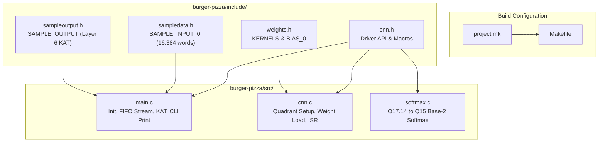

# Developer & Hardware Guide (`GUIDE.md`)

This guide documents the internal architecture, memory-mapped registers, fixed-point arithmetic, build system configuration, and steps to extend the standalone Known-Answer Test (KAT) firmware into a live camera classifier on the MAX78000.

---

## 1. Codebase Organization

The project inside [`burger-pizza/`](./burger-pizza) follows the standard Analog Devices MSDK directory layout, separating headers (`include/`) from implementation files (`src/`):



| File | Role | Edit Policy |
| :--- | :--- | :--- |
| [`burger-pizza/project.mk`](./burger-pizza/project.mk) | User build overrides (`BOARD`, `MAXIM_PATH`, compiler flags). | Safe to edit. |
| [`burger-pizza/Makefile`](./burger-pizza/Makefile) | Core MaximSDK build logic; auto-discovers `.c` in `src/` and `.h` in `include/`. | Do not edit; override in `project.mk`. |
| [`burger-pizza/src/main.c`](./burger-pizza/src/main.c) | Entry point, clock configuration, FIFO streaming (`load_input`), verification (`check_output`), and result formatting. | Safe to edit for custom I/O or camera integration. |
| [`burger-pizza/src/cnn.c`](./burger-pizza/src/cnn.c) | Register-level configuration for all 7 layers across 4 CNN quadrants, weight/bias transfer, and `CNN_ISR`. | Auto-generated by `ai8xize.py`; regenerate when changing model architecture. |
| [`burger-pizza/src/softmax.c`](./burger-pizza/src/softmax.c) | Fixed-point `softmax_q17p14_q15` and `softmax_shift_q17p14_q15` routines. | Standard library routine; rarely edited. |
| [`burger-pizza/include/cnn.h`](./burger-pizza/include/cnn.h) | Public declarations, `CNN_NUM_OUTPUTS` (`2`), timer selection (`MXC_TMR0`), and LED status macros. | Auto-generated template; safe to adjust LED/timer macros. |
| [`burger-pizza/include/weights.h`](./burger-pizza/include/weights.h) | Quantized 8-bit convolution kernels (`KERNELS`) and biases (`BIAS_0`). | Auto-generated from PyTorch checkpoint. |
| [`burger-pizza/include/sampledata.h`](./burger-pizza/include/sampledata.h) | Pre-packed `3x128x128` test image (`SAMPLE_INPUT_0`). | Auto-generated from `.npy` sample input. |
| [`burger-pizza/include/sampleoutput.h`](./burger-pizza/include/sampleoutput.h) | Expected hardware output words at `0x50401000` (`SAMPLE_OUTPUT`). | Auto-generated for Known-Answer Testing. |

---

## 2. Environment & Build Configuration

### Setting Up MaximSDK

1. Download and install the **Analog Devices MSDK (MaximSDK)** from the official Analog Devices repository.
2. Ensure the SDK path (`MAXIM_PATH`) is set in your environment or inside [`burger-pizza/project.mk`](./burger-pizza/project.mk):
   ```makefile
   BOARD = FTHR_RevA
   MAXIM_PATH = C:/MaximSDK
   ```

### Supported Boards

| Board Target (`BOARD=`) | Hardware Platform | Notes |
| :--- | :--- | :--- |
| `EvKit_V1` | MAX78000 Evaluation Kit | Default in `Makefile` if `BOARD` is unset. |
| `FTHR_RevA` | MAX78000 Feather Board | Compact form factor with `OV7692` camera header and `SW1`/`LED1`/`LED2`. |

### Common Make Targets

Run these commands from the [`burger-pizza/`](./burger-pizza) directory:

```bash
# Standard build (outputs build/max78000.elf)
make

# Optimized release build (-O2, DEBUG=0)
make release

# Debug build (-Og with debug symbols)
make DEBUG=1

# Clean project object files
make clean

# Clean both project objects and compiled peripheral driver libraries
make distclean
```

### Flashing with OpenOCD (Command Line)

```bash
openocd -f interface/cmsis-dap.cfg -f target/max78000.cfg \
  -c "program build/max78000.elf verify reset exit"
```

---

## 3. Hardware CNN Execution & Memory Map

### Key Memory-Mapped Addresses

The MAX78000 CNN accelerator is mapped into the peripheral address space starting at `0x50000000`:

| Address | Register / Region | Usage in Firmware |
| :--- | :--- | :--- |
| `0x50000000` | Global CNN Configuration | Initialized in `cnn_init()` and `cnn_configure()`. |
| `0x50000004` | FIFO Status Register | Bit 0 (`& 1`) indicates **FIFO 0 Full**. Polled in `load_input()` before each write. |
| `0x50000008` | FIFO 0 Data Write Port | Receives 16,384 packed 32-bit RGB pixels (`0x00bbggrr`). |
| `0x50100000` | Quadrant 0 Master Control | Bit 0 enables execution; bits 12 and 14 manage quadrant interrupt flags. |
| `0x50401000` | Layer 6 Output SRAM | Holds the 2 32-bit signed `Q17.14` output logits unloaded by `cnn_unload()`. |
| `0x50500000` | Quadrant 1 Control | Acknowledged in `CNN_ISR()`. |
| `0x50900000` | Quadrant 2 Control | Acknowledged in `CNN_ISR()`. |
| `0x50d00000` | Quadrant 3 Control | Acknowledged in `CNN_ISR()`. |

### Input Tensor Packing (`HWC 3x128x128`)

Layers 0 and 1 operate in **streaming mode** using the hardware input FIFO. Each pixel across the `128 x 128` frame (`16,384` pixels total) is written as one 32-bit word to `0x50000008`:

$$\text{FIFO Word} = \texttt{0x00BBGGRR}$$

Each 8-bit color channel (`R`, `G`, `B`) is signed in the range `[-128, 127]`. When converting raw unsigned 8-bit camera bytes (`[0, 255]`), XOR each byte with `0x80` (equivalent to subtracting `128`):

```c
uint8_t r_signed = r_raw ^ 0x80;
uint8_t g_signed = g_raw ^ 0x80;
uint8_t b_signed = b_raw ^ 0x80;
uint32_t fifo_word = ((uint32_t)b_signed << 16) | ((uint32_t)g_signed << 8) | r_signed;
```

### Fixed-Point Output (`Q17.14`) and Base-2 Softmax (`Q15`)

1. **Unloading Logits (`cnn_unload`)**:
   Layer 6 flattens the `16 x 8 x 8` feature map (`1024` values) and applies a linear projection to `2` outputs stored at `0x50401000`. The outputs are signed 32-bit fixed-point numbers in **Q17.14** format (1 sign bit, 17 integer bits, 14 fractional bits; scale factor $2^{14} = 16384$).
2. **Base-2 Softmax (`softmax_q17p14_q15`)**:
   Instead of computing $e^x$ in floating point, [`softmax.c`](./burger-pizza/src/softmax.c) computes a base-2 exponential using bit shifts:
   $$y_i = \frac{2^{x_i / 16384}}{\sum_{j=0}^{1} 2^{x_j / 16384}}$$
   The result is scaled to **Q15** (`[0, 32767]`, where `32768` represents `100.0%`).
3. **Percentage Conversion in `main.c`**:
   ```c
   digs = (1000 * ml_softmax[i] + 0x4000) >> 15;
   tens = digs % 10;
   digs = digs / 10;
   printf("[%7d] -> Class %d: %d.%d%%\n", ml_data[i], i, digs, tens);
   ```
   For the built-in test vector (`SAMPLE_OUTPUT`):
   - **Class 0 (Burger)**: Raw word `0x00016686` (`+91,782` in Q17.14, or $\approx +5.602$) $\rightarrow$ `ml_softmax[0] = 32760` $\rightarrow$ **`100.0%`**
   - **Class 1 (Pizza)**: Raw word `0xfffe5bd6` (`-107,562` in Q17.14, or $\approx -6.565$) $\rightarrow$ `ml_softmax[1] = 7` $\rightarrow$ **`0.0%`**

---

## 4. Extending to Live Camera Inference (`OV7692`)

The default [`src/main.c`](./burger-pizza/src/main.c) loads a static image from flash (`SAMPLE_INPUT_0`) and runs `check_output()` to verify hardware integrity. To convert this into an interactive camera classifier on the `FTHR_RevA`:

### Step 1: Enable the Camera Driver in `project.mk`

Add the camera driver and target board to [`burger-pizza/project.mk`](./burger-pizza/project.mk):

```makefile
BOARD = FTHR_RevA
PROJ_CFLAGS += -DCAMERA_OV7692
```

### Step 2: Initialize the Camera and DMA

In `main.c`, include `"camera.h"`, `"dma.h"`, `"led.h"`, and `"pb.h"`, then initialize the camera at `128x128` in `PIXEL_FORMAT_RGB888`:

```c
#define IMAGE_XRES 128
#define IMAGE_YRES 128
#define CAMERA_FREQ (5 * 1000 * 1000)

MXC_DMA_Init();
int dma_channel = MXC_DMA_AcquireChannel();
camera_init(CAMERA_FREQ);
camera_setup(IMAGE_XRES, IMAGE_YRES, PIXEL_FORMAT_RGB888, FIFO_THREE_BYTE, STREAMING_DMA, dma_channel);
```

### Step 3: Stream Camera Pixels into FIFO 0

Replace the static `input_0` array inside `load_input()` with line-by-line camera streaming, converting unsigned `[0, 255]` bytes to signed `[-128, 127]` via `^ 0x80`:

```c
void load_camera_input(void)
{
  uint8_t *raw;
  uint32_t imgLen;
  uint32_t w, h;

  camera_start_capture_image();
  camera_get_image(&raw, &imgLen, &w, &h);

  for (int y = 0; y < H; y++) {
    while ((raw = get_camera_stream_buffer()) == NULL) {
      if (camera_is_image_rcv()) break;
    }
    for (int x = 0; x < W; x++) {
      uint8_t r = raw[x * 3]     ^ 0x80;
      uint8_t g = raw[x * 3 + 1] ^ 0x80;
      uint8_t b = raw[x * 3 + 2] ^ 0x80;
      uint32_t packed = ((uint32_t)b << 16) | ((uint32_t)g << 8) | r;

      while (((*((volatile uint32_t *) 0x50000004) & 1)) != 0);
      *((volatile uint32_t *) 0x50000008) = packed;
    }
    release_camera_stream_buffer();
  }
}
```

### Step 4: Remove `check_output()` for Live Frames

Remove `if (check_output() != CNN_OK) fail();` in `main()` when classifying live camera images (since `check_output()` checks specifically for the static `SAMPLE_OUTPUT` values) and re-run `cnn_start()` before each new frame capture.

---

## 5. Regenerating the C Code (`ai8xize.py`)

The C files in this repository were generated from a Quantization-Aware Trained (QAT) PyTorch checkpoint using Analog Devices' `ai8x-synthesis` tool (`ai8xize.py`).

### Original Synthesis Command

```bash
python ai8xize.py \
  --test-dir C:\MaximSDK\Examples\MAX78000\CNN\burger_vs_pizza \
  --prefix burger-pizza \
  --overwrite \
  --checkpoint-file trained/ai85-burgerpizza-qat8-q.pth.tar \
  --config-file networks/burgerpizza-hwc.yaml \
  --sample-input tests/sample_burger_vs_pizza.npy \
  --fifo \
  --softmax \
  --device MAX78000 \
  --timer 0 \
  --display-checkpoint \
  --verbose
```

When regenerating after training a new checkpoint:
1. Copy the newly generated `weights.h`, `sampledata.h`, `sampleoutput.h`, and `cnn.h` into [`burger-pizza/include/`](./burger-pizza/include).
2. Copy the newly generated `cnn.c` into [`burger-pizza/src/`](./burger-pizza/src).
3. Rebuild with `make clean && make` and verify that the Known-Answer Test prints `*** PASS ***`.

---

## 6. Troubleshooting

| Symptom | Cause | Resolution |
| :--- | :--- | :--- |
| `Warning: MAXIM_PATH is not set!` | `Makefile` cannot locate the MaximSDK root directory. | Set `MAXIM_PATH = C:/MaximSDK` in [`burger-pizza/project.mk`](./burger-pizza/project.mk) or export `MAXIM_PATH` in your shell. |
| `Data mismatch (1/2) at address 0x50401000` | Hardware output does not match `sampleoutput.h`. | Ensure `weights.h`, `sampledata.h`, and `sampleoutput.h` came from the same `ai8xize.py` run, or remove `check_output()` if testing custom inputs. |
| Firmware hangs inside `while (cnn_time == 0)` | `CNN_ISR` never fired. | Check that `cnn_enable()` and `cnn_start()` were called before `load_input()` and that all `16,384` words were written to `0x50000008`. |
| Debugger fails to attach on reset | Core enters `MXC_LP_EnterSleepMode()` before SWD probe connects. | Hold the board reset button, start the flash/debug command, and release reset during the 2-second `MXC_Delay(SEC(2))` startup window. |
| Garbled serial output | Baud rate mismatch. | Set serial monitor to `115200` baud, `8N1`, no flow control. |
