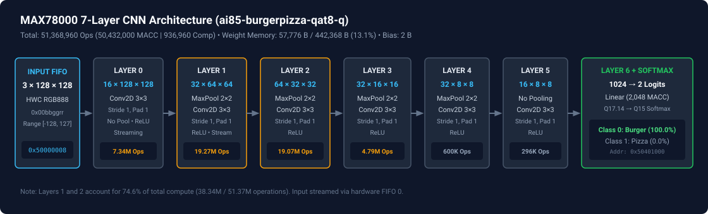
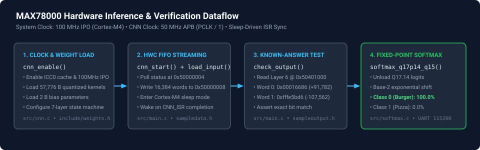
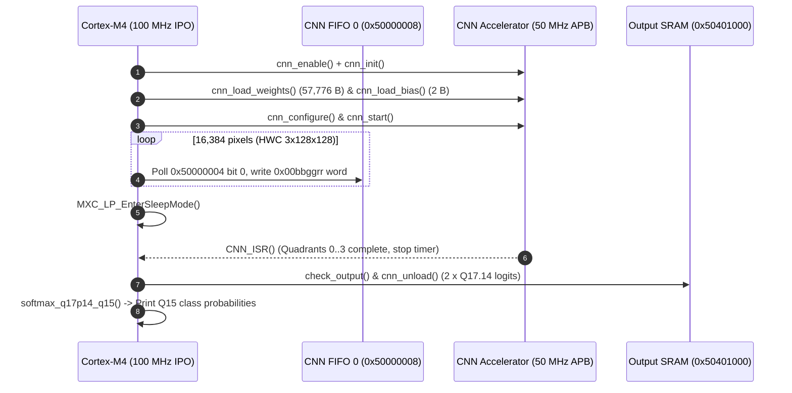

# Burger vs. Pizza Classifier on MAX78000

Hardware-accelerated binary image classification (`Burger` vs. `Pizza`) running on the Analog Devices **MAX78000** neural network microcontroller. The firmware is synthesized from the quantized checkpoint `ai85-burgerpizza-qat8-q.pth.tar` (`burgerpizza-hwc.yaml`) using `ai8xize.py` and streams `128x128` RGB images through the on-chip Convolutional Neural Network (CNN) accelerator via hardware FIFO.

For an in-depth walkthrough of the register map, fixed-point math, build customization, and live camera integration, see [GUIDE.md](./GUIDE.md).

---

## Visual Overview

### 1. 7-Layer CNN Architecture



### 2. Hardware Inference & Verification Dataflow



### 3. Runtime Execution Sequence



---

## Repository Structure

```text
Burger_vs_Pizza---MAX78000/
├── README.md                        # Project overview, architecture visuals, and quick start
├── GUIDE.md                         # Developer guide, register map, camera integration, and retraining
├── docs/
│   └── assets/
│       ├── cnn-architecture.svg     # 7-layer CNN pipeline diagram
│       └── hardware-dataflow.svg    # Hardware FIFO, KAT, and Softmax dataflow diagram
└── burger-pizza/
    ├── Makefile                     # MaximSDK build rules (auto-discovers src/ and include/)
    ├── project.mk                   # Project-level overrides (BOARD, MAXIM_PATH, compiler flags)
    ├── include/
    │   ├── cnn.h                    # CNN driver API, timer macros, and Q31/Q15 typedefs
    │   ├── weights.h                # Quantized 8-bit convolution kernels (57,776 B) and bias (2 B)
    │   ├── sampledata.h             # Known-Answer Test input tensor (HWC 3x128x128)
    │   └── sampleoutput.h           # Expected Layer 6 hardware register values for verification
    └── src/
        ├── main.c                   # System initialization, FIFO loader, KAT check, and UART output
        ├── cnn.c                    # Quadrant register setup, weight loader, and CNN_ISR handler
        └── softmax.c                # Base-2 fixed-point softmax (Q17.14 input to Q15 output)
```

---

## CNN Model Specifications

The network takes a `3x128x128` HWC tensor (49,152 bytes packed into 16,384 32-bit words as `0x00bbggrr` with signed channel values in `[-128, 127]`) and produces 2 output logits at Layer 6.

| Layer | Input Shape (C×H×W) | Pooling | Kernel / Operation | Activation | Output Shape (C×H×W) | MACC Ops | Comparisons | Total Ops |
| :---: | :---: | :---: | :---: | :---: | :---: | ---: | ---: | ---: |
| **0** | `3 × 128 × 128` (FIFO) | None | Conv2D `3×3`, stride 1, pad 1 | ReLU | `16 × 128 × 128` | 7,077,888 | 262,144 | 7,340,032 |
| **1** | `16 × 128 × 128` (Stream) | MaxPool `2×2`, stride 2 | Conv2D `3×3`, stride 1, pad 1 | ReLU | `32 × 64 × 64` | 18,874,368 | 393,216 | 19,267,584 |
| **2** | `32 × 64 × 64` | MaxPool `2×2`, stride 2 | Conv2D `3×3`, stride 1, pad 1 | ReLU | `64 × 32 × 32` | 18,874,368 | 196,608 | 19,070,976 |
| **3** | `64 × 32 × 32` | MaxPool `2×2`, stride 2 | Conv2D `3×3`, stride 1, pad 1 | ReLU | `32 × 16 × 16` | 4,718,592 | 73,728 | 4,792,320 |
| **4** | `32 × 16 × 16` | MaxPool `2×2`, stride 2 | Conv2D `3×3`, stride 1, pad 1 | ReLU | `32 × 8 × 8` | 589,824 | 10,240 | 600,064 |
| **5** | `32 × 8 × 8` | None | Conv2D `3×3`, stride 1, pad 1 | ReLU | `16 × 8 × 8` | 294,912 | 1,024 | 295,936 |
| **6** | `1024 × 1 × 1` (Flattened) | None | Linear (`1024 -> 2`) | None | `2 × 1 × 1` | 2,048 | 0 | 2,048 |
| **Total** | | | | | | **50,432,000** | **936,960** | **51,368,960** |

### Hardware Resource Utilization

| Resource | Used | Available on MAX78000 | Utilization |
| :--- | ---: | ---: | ---: |
| **Weight Memory** | 57,776 bytes | 442,368 bytes | **13.1%** |
| **Bias Memory** | 2 bytes | 2,048 bytes | **0.1%** |
| **System Clock (Cortex-M4)** | 100 MHz (IPO) | 100 MHz | 100% |
| **CNN Accelerator Clock** | 50 MHz (APB PCLK / 1) | 50 MHz | 100% |

---

## Quick Start

### Prerequisites

1. **Analog Devices MSDK (MaximSDK)** installed (default path `C:/MaximSDK` on Windows).
2. **ARM GNU Toolchain** (`arm-none-eabi-gcc`) and **Make** (bundled with MaximSDK).
3. **MAX78000 Board**: Evaluation Kit (`EvKit_V1`, default) or Feather (`FTHR_RevA`).
4. **Serial Terminal**: `115200` baud, 8 data bits, no parity, 1 stop bit (`8N1`).

### Build & Run

```bash
cd burger-pizza

# Build for the default EvKit_V1 board
make MAXIM_PATH=C:/MaximSDK

# Or build specifically for the MAX78000 Feather (FTHR_RevA)
make MAXIM_PATH=C:/MaximSDK BOARD=FTHR_RevA
```

To persist `BOARD` or `MAXIM_PATH` across builds without passing command-line flags, uncomment them in [`burger-pizza/project.mk`](./burger-pizza/project.mk).

### Expected Serial Output (Known-Answer Test)

When flashed to the board, the firmware executes the Known-Answer Test against `SAMPLE_INPUT_0` ([`sampledata.h`](./burger-pizza/include/sampledata.h)) and verifies Layer 6 output at `0x50401000` against [`sampleoutput.h`](./burger-pizza/include/sampleoutput.h) (`0x00016686` and `0xfffe5bd6`):

```text
Waiting...

*** CNN Inference Test burger-pizza ***

*** PASS ***

Approximate data loading and inference time: 10842 us

Classification results:
[  91782] -> Class 0: 100.0%
[-107562] -> Class 1: 0.0%
```

---

## Documentation & Further Reading

- **[Developer & Hardware Guide (GUIDE.md)](./GUIDE.md)**: Detailed walkthrough of memory-mapped CNN registers, Q17.14 fixed-point Softmax math, replacing the static FIFO test vector with live `OV7692` camera DMA capture, and regenerating weights with `ai8xize.py`.

## License

Copyright (C) 2019-2024 Maxim Integrated Products, Inc. (now Analog Devices, Inc.), All Rights Reserved. Fixed-point softmax routines include portions Copyright (C) 2010-2018 Arm Limited (Apache-2.0).
